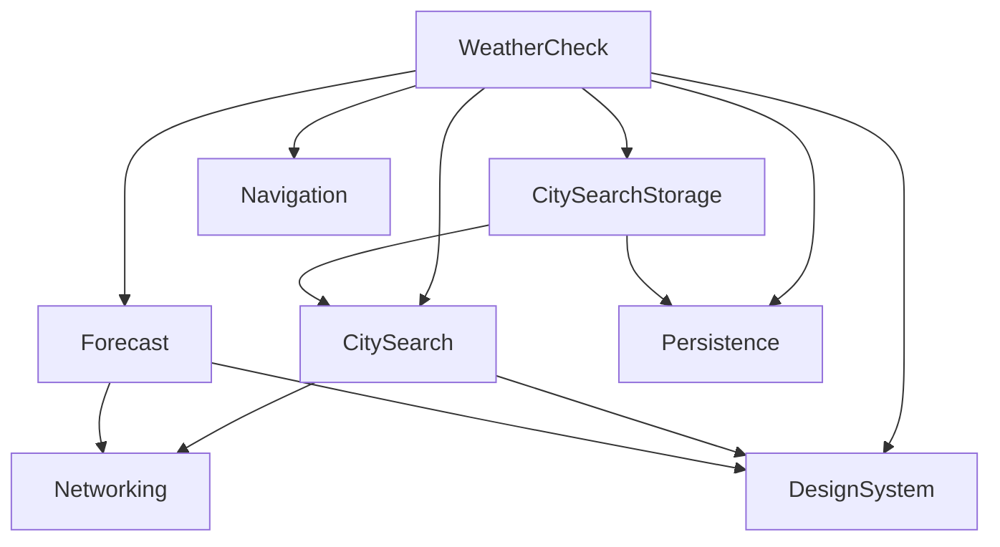

# WeatherCheck

Aplikacja pogodowa na iOS przygotowana jako zadanie rekrutacyjne dla Empik. Pozwala wyszukać miasto, zobaczyć jego prognozę i wrócić do ostatnich wyszukiwań, także bez internetu.

## Funkcje

- **Wyszukiwanie miast** (Open-Meteo Geocoding, polskie nazwy):
  - wyszukuje od 2 znaków, 300 ms po ostatnim wpisanym znaku;
  - sprawdza nazwę przed wysłaniem: litery (także polskie), spacje i myślniki, 2–100 znaków;
  - pogrubia w wynikach wpisany początek nazwy.
- **Historia** ostatnich 10 wyszukiwań zapisana na urządzeniu (Core Data), z usuwaniem pojedynczych wpisów i czyszczeniem całości.
- **Prognoza** (Open-Meteo Forecast): aktualne warunki, zachmurzenie, szansa opadów, najbliższe 24 godziny, 7 dni z paskami zakresu temperatur, pull-to-refresh.
- **Stany ekranów:** ładowanie, brak wyników, niepoprawna nazwa, błąd API (z treścią od Open-Meteo) i brak internetu.
- **Brak internetu:** baner nad historią, wynikami i prognozą. Po powrocie połączenia wyszukiwanie i prognoza odświeżają się same.
- **Tryb ciemny, Dynamic Type i VoiceOver.**
- **SSL pinning** dla hostów Open-Meteo.
- **Ikona Liquid Glass** z Icon Composer i ekran startowy.

## Wymagania

- Xcode 26.0 lub nowszy (Swift 6.2).
- iOS 17.0 lub nowszy, iPhone i iPad.
- Bez kluczy API i zewnętrznych bibliotek.

## Uruchomienie

1. Projekt otwiera się w Xcode przez plik `WeatherCheck.xcodeproj`.
2. Aplikację uruchamia schema **WeatherCheck** na symulatorze albo urządzeniu z iOS 17 lub nowszym: Product → Run (⌘R).
3. Na fizycznym urządzeniu potrzebny jest własny zespół w **Signing & Capabilities** targetu WeatherCheck.

### Testy

Product → Test (⌘U) uruchamia plan testów `WeatherCheck.xctestplan`: testy jednostkowe wszystkich pakietów i testy integracyjne Core Data.

Błędy Core Data w konsoli są oczekiwane: część testów integracyjnych celowo otwiera uszkodzony albo zablokowany plik historii.

### Dodatkowe informacje

- **Proxy do debugowania** (Proxyman, Charles) nie zadziała z powodu SSL pinningu. Na czas debugowania trzeba usunąć `NSPinnedDomains` z `WeatherCheck/Info.plist`.
- **Ekran startowy jest zapamiętywany przez system.** Po jego zmianie nowa wersja pojawia się dopiero po usunięciu aplikacji z symulatora.
- **Xcode 26 i 27 na jednym Macu:** po przełączeniu może pojawić się ostrzeżenie „Could not read priors…”. Jest nieszkodliwe i znika po Product → Clean Build Folder.
- **Format projektu:** ścisła walidacja projektu w Xcode 27 i format JSON (`project.xcproj`, od Xcode 27.2) muszą pozostać wyłączone. W obu przypadkach Xcode 26 nie otworzy projektu.

## Struktura projektu

```
WeatherCheck/
├── WeatherCheck/                 # target aplikacji: łączy moduły w całość
│   ├── Root/                     # WeatherCheckApp, RootView (nawigacja), Destination
│   ├── History/                  # mapowanie wybranego miasta na lokalizację prognozy
│   ├── Assets.xcassets           # ikona ekranu startowego i eksport ikony aplikacji
│   ├── AppIcon.icon              # ikona z Icon Composer
│   ├── LaunchScreen.storyboard
│   └── Info.plist                # SSL pinning (NSPinnedDomains)
├── Networking/                   # budowanie zapytań, wysyłka, błędy, dekodowanie, monitor sieci
│   └── NetworkingTestHelpers     # fake'i wspólne dla testów innych modułów
├── Navigation/                   # NavigationStore i NavigationContainer: typowana ścieżka NavigationStack
├── DesignSystem/                 # kolory (Palette), czcionki (Typography), odstępy (Spacing, Padding)
├── Persistence/                  # stos Core Data, wersjonowane schematy, migracje progresywne
│   ├── PersistenceTestHelpers
│   └── PersistenceTestFixtures
├── CitySearch/                   # ekran wyszukiwania: API, walidacja, historia, UI
│   └── CitySearchStorage         # historia w Core Data: schemat i plan migracji
├── Forecast/                     # ekran prognozy: API, mapowanie odpowiedzi, UI
├── WeatherCheckTests/
├── WeatherCheckUITests/
└── WeatherCheck.xctestplan
```

Moduły funkcji (`CitySearch`, `Forecast`) mają ten sam układ:

```
Sources/<Moduł>/
├── Models/            # typy domenowe i walidacja
├── Networking/        # endpointy, klient, odpowiedzi API, mapowanie błędów
├── Storage/           # tylko CitySearch: magazyn historii
├── UI/                # ekran, view model, teksty, dane do podglądów
│   └── Components/    # widoki składowe, jeden na plik
└── Resources/         # Localizable.xcstrings
```

Zależności między modułami:



`CitySearch` i `Forecast` nie wiedzą o sobie nawzajem. Łączy je `RootView`, który zamienia wybrane miasto (`City`) na lokalizację prognozy (`ForecastLocation`).

### Architektura w skrócie

- **MVVM:** widoki SwiftUI i view modele `@Observable` na main actorze, stan ekranu jako enum.
- **Zależności wstrzykiwane przez init**, ukryte za protokołami.
- **Swift 6 w całym projekcie**, dekodowanie JSON-a poza main actorem (`@concurrent`).
- **Testy w Swift Testing**, testy integracyjne Core Data w osobnych targetach.

## Decyzje techniczne

- **Moduły jako lokalne pakiety Swift.** Każdy buduje się i testuje osobno, a granic między nimi pilnuje kompilator: to, co nie jest `public`, nie wychodzi poza moduł.
- **Core Data z wersjonowanymi schematami i migracjami, choć historia ma 10 pozycji.** Zadanie każe traktować aplikację jak produkcyjną, a tam dane użytkowników muszą przetrwać zmianę schematu po wydaniu. `Persistence` nie zna żadnej funkcji, więc kolejna (np. prognoza offline) użyje go bez zmian.
- **Własny migrator krok po kroku.** Automatyczna migracja Core Data przechodzi tylko wprost do bieżącej wersji, a etapy z iOS 17 (`NSStagedMigrationManager`) nie przyjmują mapowań z politykami encji.
- **Historia oddzielona od Core Data.** Reguły listy są w `CitySearch`, a Core Data tylko w `CitySearchStorage`, więc reguły testuje się bez bazy, a magazyn można wymienić (np. na SwiftData) bez ich zmiany.
- **Nieczytelny plik historii jest zakładany od nowa.** Historię łatwo odbudować, więc jednorazowa utrata kosztuje mniej niż historia trzymana tylko w pamięci aż do reinstalacji. Gdy i to zawiedzie, aplikacja działa dalej bez zapisu.
- **Miasto trafia do historii po wybraniu z wyników**, a nie po wpisaniu, bo wpisywane frazy zawierałyby literówki i fragmenty nazw.
- **Pinning kluczy głównych Let's Encrypt (ISRG), a nie certyfikatu serwera.** Piny zmienia tylko aktualizacja aplikacji, a klucz serwera zmienia się przy odnowieniu certyfikatu, certyfikaty pośrednie zaś bez zapowiedzi.
- **Cache HTTP z `URLSession.shared` zamiast własnego.** Wyniki wyszukiwania są pamiętane przez 24 godziny zgodnie z nagłówkami Open-Meteo, prognoza jest zawsze pobierana na nowo, a „Spróbuj ponownie” zawsze pyta serwer.

## Dodatkowa funkcjonalność - przy założeniu dodatkowego czasu

### Design

- **Projekt od projektanta** zamiast systemowych komponentów, ponieważ zadanie nie zawierało makiet.
- **Układ dla iPada** z wyszukiwaniem i prognozą obok siebie (`NavigationSplitView`).
- **Więcej danych pogodowych** (wiatr, wilgotność, ciśnienie, indeks UV) i wykresy w Swift Charts.
- **Bieżąca lokalizacja** jako pierwszy wynik i lista ulubionych miast.
- **Dostępność** z pełnym przeglądem VoiceOver, największymi rozmiarami Dynamic Type i Reduce Motion.
- **Angielska wersja językowa** w istniejących String Catalogs i stopnie Fahrenheita.
- **Widżety** z prognozą dla ostatniego miasta.

### Implementacja

- **Dependency Injection** z wykorzystaniem Swift-Dependencies.
- **Testy UI** głównych ścieżek z siecią podmienianą przez argumenty uruchomienia.
- **Testy snapshotów** ekranów w trybie jasnym, ciemnym i z dużymi czcionkami.
- **CI** z wykorzystaniem GitHub Actions do budowania, testowania i lintowania na Xcode 26 i 27.
- **Prognoza offline** z ostatnią zapisaną prognozą zamiast ekranu błędu.
- **Wspólny dekoder błędów Open-Meteo** zamiast osobnych kopii w CitySearch i Forecast.
- **Osobne mappery** zamiast logiki w typach danych (`City`, `SearchError`, `SearchHistoryRetention`, `CityEntity`), tak jak `ForecastMapper`.
- **Ponawianie zapytań** z narastającym odstępem przy przejściowych błędach sieci.
- **SSL pinning** z osobnym komunikatem błędu weryfikacji i zapasowymi kluczami na wypadek zmiany CA.
